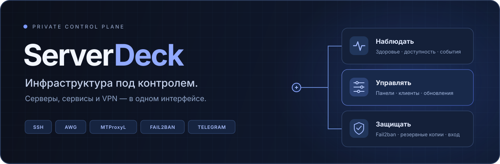

<a id="top"></a>

<p align="center">
  
</p>

<h1 align="center">VPS, VPN и сервисы — в одном окне</h1>

<p align="center">
  Следите за состоянием серверов, управляйте клиентами и панелями,<br>
  готовьте обновления и сохраняйте резервные копии через SSH.
</p>

<p align="center">
  <a href="#быстрый-старт"><strong>Установить</strong></a> ·
  <a href="#возможности">Возможности</a> ·
  <a href="docs/FEATURES.md">Интерактивное руководство</a> ·
  <a href="docs/VPS.md">Выбрать VPS</a> ·
  <a href="docs/SECURITY.md">Безопасность</a>
</p>

---

## Возможности

| Наблюдать и управлять | Обслуживать и защищать |
|---|---|
| **01 · Серверы и доступность**<br>CPU, память, диск, systemd, Docker и история измерений. При потере SSH — отдельная диагностика через Cheburcheck и настроенную точку РФ.<br>[Мониторинг →](docs/FEATURES.md#health) · [Диагностика →](docs/FEATURES.md#availability) | **02 · Обновления и компоненты**<br>Установленная и опубликованная версия, понятные статусы, планы обновления и пакеты ОС. Каталог поддерживаемых рецептов и публичных Git-проектов.<br>[Обновления →](docs/FEATURES.md#updates) · [Каталог →](docs/FEATURES.md#catalog) |
| **03 · VPN, прокси и клиенты**<br>LucX / 3x-ui и MTProxyL внутри интерфейса. Настройки доступа, квоты, сроки, ссылки подключения и доступный экспорт конфигураций AWG.<br>[Панели →](docs/FEATURES.md#panels) · [Клиенты →](docs/FEATURES.md#clients) | **04 · Резервные копии**<br>Зашифрованные архивы поддерживаемых панелей, скачивание, проверка целостности, отдельный ключ восстановления и подтверждаемое восстановление.<br>[Копии и восстановление →](docs/FEATURES.md#backups) |
| **05 · Telegram и мобильный доступ**<br>Меню статусов серверов и служб, критические события и восстановление. Подтверждаемые перезапуски. Android PWA при доверенном HTTPS-домене.<br>[Бот →](docs/FEATURES.md#telegram) · [Вход и PWA →](docs/FEATURES.md#account) | **06 · Защита и контроль действий**<br>Источники SSH-попыток и блокировки. Редактор Fail2ban `sshd` с предпросмотром. История задач и ручная проверка неопределённого результата.<br>[Fail2ban →](docs/FEATURES.md#security) · [Задачи →](docs/FEATURES.md#jobs) |

**С чего начать:** [добавить первый сервер](docs/FEATURES.md#servers) · [подключить панель](docs/FEATURES.md#panels) · [создать копию](docs/FEATURES.md#backups) · [настроить уведомления](docs/FEATURES.md#telegram)

## Быстрый старт

| Контроллер | Доступ администратора | HTTPS |
|---|---|---|
| Отдельный **Ubuntu 24.04** или **Debian 12** с systemd | OpenSSH и браузер на Windows, macOS или Linux; Android — браузер/PWA | Домен через Certbot / Let's Encrypt либо IP и случайный высокий порт с собственным сертификатом |

Выберите свой способ запуска. Недостающие компоненты устанавливаются автоматически; используется системный Python 3.9–3.12.

<details open>
<summary><strong>С моего компьютера — установить на Linux VPS по SSH</strong></summary>

Замените `VPS` адресом отдельного сервера и выполните команду в терминале Windows, macOS или Linux:

```sh
ssh -t root@VPS "bash -o pipefail -c 'if ! command -v curl >/dev/null || [ ! -s /etc/ssl/certs/ca-certificates.crt ]; then apt-get -o APT::Update::Error-Mode=any update && apt-get install -y --no-install-recommends curl ca-certificates || exit; fi; curl -fsSL https://raw.githubusercontent.com/Atlantik56/ServerDeck/main/scripts/install.sh | bash'"
```

Для другого SSH-порта или ключа добавьте параметры `ssh -p ПОРТ -i ПУТЬ root@VPS`. Сначала проверьте отпечаток хоста по доверенному каналу. Параметр `-t` выделяет терминал для вопросов мастера.

[Подготовка VPS, параметры и примеры →](docs/SETUP.md)

</details>

<details>
<summary><strong>Я уже подключён к Linux VPS — запустить мастер здесь</strong></summary>

Под пользователем с sudo выполните команду ниже. В root-сессии уберите начальное `sudo`:

```sh
sudo bash -o pipefail -c 'if ! command -v curl >/dev/null || [ ! -s /etc/ssl/certs/ca-certificates.crt ]; then apt-get -o APT::Update::Error-Mode=any update && apt-get install -y --no-install-recommends curl ca-certificates || exit; fi; curl -fsSL https://raw.githubusercontent.com/Atlantik56/ServerDeck/main/scripts/install.sh | bash'
```

Корневая ссылка `install.sh` также сохранена как совместимый переход. Основной bootstrap находится в `scripts/install.sh`.

</details>

**Что происходит при установке**

1. Команда обеспечивает наличие curl и доверенных CA-сертификатов. При необходимости bootstrap доустанавливает Python и tar.
2. Мастер запрашивает настройки, показывает план и получает ваше подтверждение.
3. После проверки чистого хоста обязательно выполняются **`apt update` → `apt upgrade -y` → установка недостающих зависимостей → проверка компонентов**.
4. Устанавливаются службы панели и настраивается HTTPS. В конце выводится адрес и одноразовый код первого входа.

Для скрипта используются `apt-get`, разрешение новых зависимостей, запрет удаления пакетов и сохранение локальных конфигураций. Ошибка подготовки останавливает установку панели. Автоматической перезагрузки VPS нет; пакетные скрипты ОС могут перезапускать службы, поэтому мастер рассчитан на отдельный чистый хост.

### Домен или IP?

| С доменом | Пока без домена |
|---|---|
| A-запись на VPS, входящие TCP 80/443; для встроенных панелей — DNS `*.ваш-домен`. Основной сертификат выпускает Certbot. | Публичный IPv4, свободный случайный высокий HTTPS-порт и собственный сертификат. Разрешите выбранный порт в firewall и сверьте отпечаток сертификата через SSH перед вводом данных. |
| Подходит для постоянного доступа и PWA. | Домен можно подключить позднее в настройках. Для PWA и встроенных панелей с отдельными именами нужен доверенный HTTPS-домен. |

## Первый вход

**Установка → ваш аккаунт → первый VPS → панели и копии**

1. **Создайте владельца.** Откройте показанный адрес `/login/`, введите одноразовый код из вывода установщика и задайте свои логин и пароль. Код действует один час; готовой учётной записи нет.
2. **Добавьте сервер.** Создайте Ed25519-ключ в форме или выберите существующий, установите публичную часть показанной командой и проверьте SSH-отпечаток целевого хоста.
3. **Подключите сервисы.** Откройте единое меню управления VPS, добавьте поддерживаемые панели и нужные службы.
4. **Подготовьте наблюдение и восстановление.** Настройте Telegram, создайте первую резервную копию и отдельно сохраните ключ восстановления.

Новая установка начинает с пустого реестра. Авторские VPS, SSH-ключи, токены, пароли, получатель Telegram и пользовательские архивы в репозиторий не включены.

## Какой VPS выбрать

**Для группы из шести серверов: 2 vCPU · 4 ГБ RAM · 40 ГБ SSD/NVMe · Ubuntu Server 24.04 LTS.**

Это отправная конфигурация, а не результат нагрузочного теста. Нужны постоянный публичный IPv4 и доступ к консоли восстановления провайдера. Объём архива и число сохранённых копий определяют дополнительное место на диске.

[Ресурсы, размещение, сеть и расчёт диска →](docs/VPS.md)

## Документация

| Хочу… | Открыть |
|---|---|
| Разобраться во всех разделах и значениях статусов | [Руководство по функциям — 15 разделов](docs/FEATURES.md) |
| Установить панель, настроить домен, SSH и Telegram | [Установка и настройка](docs/SETUP.md) |
| Выбрать конфигурацию и расположение контроллера | [Рекомендации по VPS](docs/VPS.md) |
| Понять привилегии, хранение секретов и границы защиты | [Безопасность и данные](docs/SECURITY.md) |
| Восстановить поддерживаемую панель из копии | [Копии и восстановление](docs/FEATURES.md#backups) |

<details>
<summary><strong>Исходники и разработка — структура проекта и команды</strong></summary>

```text
ServerDeck/
├── backend/             # API, мониторинг, адаптеры SSH, задачи и помощники
├── frontend/
│   ├── static/          # HTML, CSS и JavaScript панели
│   └── pwa/             # Вход, первый запуск, manifest, service worker и значки
├── installer/           # Мастер, установка Linux, шаблоны и recovery-утилиты
├── scripts/             # Bootstrap и запуск тестов
├── tests/
│   ├── python/          # Backend и установщик
│   └── browser/         # JS-проверки и браузерные сценарии
├── docs/                # Руководства и иллюстрации
├── install.sh           # Совместимость прежней ссылки
├── README.md
└── LICENSE
```

Из корня клонированного репозитория:

```sh
python3 installer/install.py --help
python3 installer/install.py --dry-run
python3 scripts/test.py
```

Python-мастер запускается на Windows, macOS или Linux для установки через SSH; на Windows при необходимости используйте `py -3 installer/install.py`. `--dry-run` показывает план без установки.

Полный Python-набор тестов требует Linux, macOS или WSL из-за Unix-зависимостей. `python3 scripts/test.py --browser` дополнительно запускает браузерные сценарии и требует Node.js, Playwright и Chromium. [Подготовка среды и другие команды →](docs/SETUP.md)

Это структура исходников. Установщик собирает рабочие файлы в `/opt/server-deck` и сохраняет служебные пути установленной панели. Вручную перемещать действующую установку при обновлении структуры Git не требуется.

</details>

<details>
<summary><strong>Границы возможностей — что учитывать при управлении</strong></summary>

- Server Deck — привилегированный административный инструмент. Доступ к панели может дать доступ к управляемым VPS и содержимому копий. Используйте отдельный контроллер и храните копии и ключ восстановления вне него.
- Git-ссылка добавляет сведения проекта и релизы. Автоматическая установка требует поддерживаемого рецепта; версия, указанная вручную, так и помечается.
- Ошибка SSH не доказывает блокировку ТСПУ, handshake не проверяет весь VPN, опубликованное исправление ядра не означает, что оно уже установлено и запущено.
- Проверка целостности копии и успешный тест не заменяют проверку восстановления и реального клиентского VPN-трафика.
- Изменения имеют свои подтверждения и область воздействия. Неопределённый результат опасной операции требует проверки перед новым запуском.

[Полное описание ограничений и сценариев →](docs/FEATURES.md)

</details>

---

<p align="center">
  <a href="#top">В начало ↑</a> · <a href="LICENSE">MIT License</a> · <a href="docs/FEATURES.md">Руководство</a>
</p>
